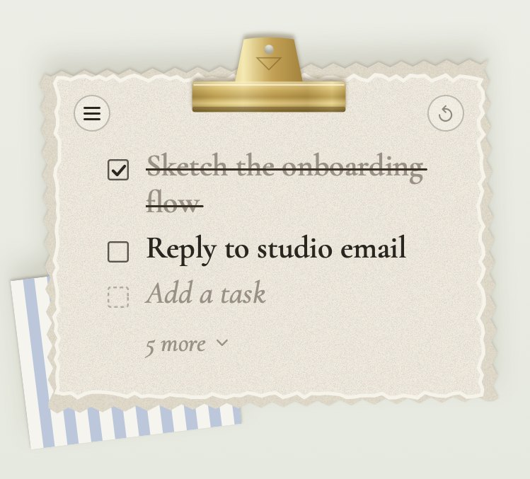

# Sticky Note Scrapbook

A to-do note that hangs on your Mac desktop like a page from a scrapbook. It folds down to a single brass clip, wax seal or torn-paper scrap, shows your next two tasks when opened, and the whole list when you ask for it.

**Requires** macOS 15 or later. Universal build (Apple Silicon and Intel).

## Get it

**Download:** grab `Sticky.Note.zip` from [Releases](../../releases/latest), unzip it, drag **Sticky Note** into Applications and open it. If macOS says it can't check the app: System Settings → Privacy & Security → Open Anyway.

**With Claude Code:** clone this repo, run `claude` inside it, and say *Install Sticky Note Scrapbook*. Claude builds it on your Mac with the skill in `.claude/skills/`, so there's no security prompt.

**Build it yourself:** with Xcode 16 or later, or recent Command Line Tools (macOS 15 SDK or newer), run `./app/build.sh`, then copy `app/build/Sticky Note.app` to Applications.

## Using it

- Click the clip, seal or scrap to open the note; click it again to fold it away. Folding tucks it against the nearest screen edge.
- Tick a task and it moves below the open ones. Hover a task and click **×** to delete it.
- **5 more** shows every task; **Show less** goes back to two.
- ☰ (top left) switches the look. ↺ (top right) starts a fresh page, with a 5-second Undo.
- ⌘C ⌘X ⌘V ⌘A ⌘Z work. Pasting a list adds one task per line.
- Near a screen edge, the note glides itself into view when it opens.

Tasks stay on your Mac in `~/Library/Application Support/StickyNote/scrapbook-todos.json`. No accounts, no network.

## Project

| Path | What |
| --- | --- |
| `app/` | SwiftUI + AppKit source, `build.sh`, bundled fonts and icon |
| `app/Snapshot.swift` | Debug-only build (`-D SNAPSHOT`): renders every state to PNG and runs the paste and fit-on-screen checks |
| `handoff/` | The project's web page |
| `.claude/skills/` | The Claude Code install skill |

Fonts: Cormorant Garamond, EB Garamond and Courier Prime, all under the SIL Open Font License (`app/Resources/OFL.txt`).
