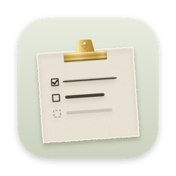
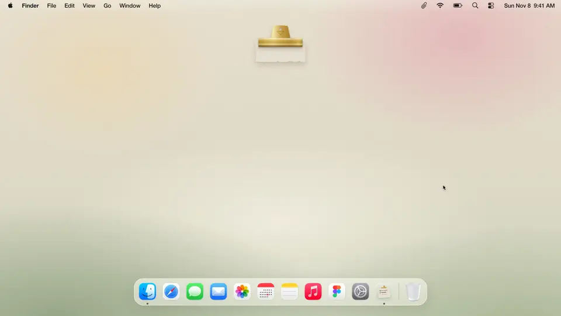
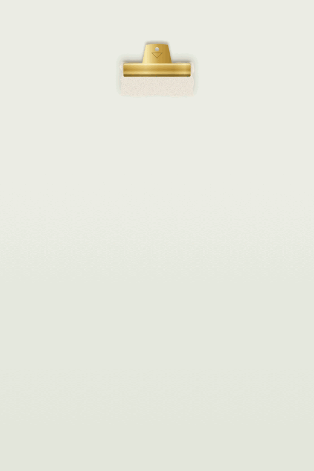

  

<h1 align="center">Sticky Note Scrapbook</h1>

  <strong>A to-do list and notepad that hangs on your Mac desktop like a page from a scrapbook.</strong> 
  Free, private, and simple. No account needed.

  <a href="https://github.com/AakankshaChaubey14/StickyNotesApp/releases/latest/download/Sticky.Note.dmg">
    <picture>
      <source media="(prefers-color-scheme: dark)" srcset="https://img.shields.io/badge/Download_for_Mac-f0eadd?style=for-the-badge&logo=apple&logoColor=2c2822">
      
    </picture>
  </a> 
  Free · macOS 15 or later · Apple Silicon and Intel

   
  Click to watch the full video

## Install in 3 steps

1. **Download:** click **Download for Mac** above.
2. **Install:** open the downloaded `Sticky.Note.dmg` and drag **Sticky Note** onto the **Applications** folder.
3. **Open:** double-click **Sticky Note** in your Applications folder. The note opens with a few tips to get you started.

> **Does your Mac say it "can't check" the app?**
> That's normal for small free apps that haven't paid Apple for verification yet. To open it, go to **System Settings → Privacy & Security**, scroll down, and click **Open Anyway**. You only need to do this once.

## What it does

- 📎 **Open and fold:** click the clip to open your note. Click it again to tuck it away at the edge of your screen.
- ☑️ **Tick off tasks:** finished tasks move to the bottom. Hover over a task and click **×** to delete it.
- ↕️ **Reorder:** drag the dots to the left of a task to move it up or down. Long lists scroll inside the note.
- 📝 **Write notes:** switch to **Notes** at the top of the note for anything that isn't a to-do.
- ✍️ **Bold and bullets:** select some words and press **B**. In Notes, type **-** and a space (or tap the list button) to start a bulleted list.
- 🎨 **Three looks:** brass clip, wax seal or torn paper. Switch with the **☰** button.
- ↺ **Start fresh:** clear the page in one click, with 5 seconds to undo.
- 🔒 **Private:** your tasks and notes stay on your Mac. No account, no internet, no tracking.

  <picture>
    <source media="(prefers-color-scheme: dark)" srcset=".github/images/demo-dark.gif">
    
  </picture>

## Questions

<strong>Is it really free?</strong>

Yes, completely. It's open source under the MIT License.

<strong>How do I close it?</strong>

Right-click the Sticky Note icon in your Dock (or the note itself, or the folded clip) and choose **Quit Sticky Note**.

<strong>Can I hide the Dock icon?</strong>

Yes. Click the 📎 paperclip in the menu bar at the top of your screen and untick **Show in Dock**.

<strong>Will it open when I start my Mac?</strong>

Yes, it starts automatically. To stop that, click the 📎 paperclip in the menu bar and untick **Open at Login**.

<strong>How do I update to a new version?</strong>

Download the latest version with the button above and install it the same way. It replaces the old one, and your tasks and notes stay just as they were.

<strong>How do I uninstall it?</strong>

Quit the app, then drag **Sticky Note** from Applications to the Trash. To also delete your tasks and notes, delete the folder `~/Library/Application Support/StickyNote`.

<strong>Which Macs does it work on?</strong>

Any Mac with macOS 15 (Sequoia) or later, Apple Silicon or Intel.

## Feedback

We'd love to hear how you use it and what you'd change.

- 💡 Ideas, questions or general feedback: [Discussions](../../discussions)
- 🐞 Something not working? [Report a bug](../../issues/new?template=bug_report.yml)
- ✨ Want something new? [Request a feature](../../issues/new?template=feature_request.yml)
- 💼 Collaboration, press or anything else: [Get in touch](../../issues/new?template=contact.yml)

## Made by

Dreamed up and built by **Aakanksha Chaubey** ([@AakankshaChaubey14](https://github.com/AakankshaChaubey14))  
Designed and dressed by **Daria Meshcheriakova** ([@dmeshcheriakova136](https://github.com/dmeshcheriakova136))

*Co-developed with care, one sticky note at a time.*

<strong>For developers</strong>

**With Claude Code:** clone this repo, run `claude` inside it, and say *Install Sticky Note Scrapbook*. Claude builds it on your Mac with the skill in `.claude/skills/`, so there's no security prompt.

**Build it yourself:** with Xcode 16 or later, or recent Command Line Tools (macOS 15 SDK or newer), run `./app/build.sh`, then copy `app/build/Sticky Note.app` to Applications. `./app/make-dmg.sh` packages it as a `.dmg`.

Tasks and notes are saved in `~/Library/Application Support/StickyNote/` (`scrapbook-todos.json` and `scrapbook-notepad.json`).

| Path | What |
| --- | --- |
| `app/` | SwiftUI + AppKit source, `build.sh`, `make-dmg.sh`, bundled fonts and icon |
| `app/Notepad.swift` | The Notes page and the bold / italic formatting shared with tasks |
| `app/Snapshot.swift` | Debug-only build (`-D SNAPSHOT`): renders every state to PNG and runs the paste and fit-on-screen checks |
| `handoff/` | The project's web page |
| `.claude/skills/` | The Claude Code install skill |
| `.github/` | Feedback forms and the README pictures |

Fonts: Cormorant Garamond, EB Garamond and Courier Prime, all under the SIL Open Font License (`app/Resources/OFL.txt`).

## License

Open source under the [MIT License](LICENSE). You're free to use, change and share it; just keep the copyright notice.
